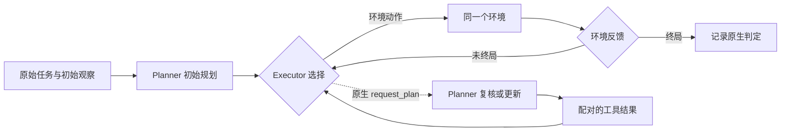

# 高层规划器优化：战略探索与执行证据驱动的学习

> Research Proposal v0.6 · 本轮协议修订待审核\
> v0.5 的原审核对应 2026-11-18 正文及配图，不自动覆盖本轮修改。\
> [研究者审核记录](RESEARCH.md#decisions) · [新实验协议与设置](experiments/planner-centered-v2/README.md)

## 摘要

本研究关注如何在固定 Executor 的条件下，通过战略探索、执行证据支持的低成本评价和策略更新，改善高层 Planner 的任务表现。研究愿景保持不变，当前工作先开展独立的 `planner-centered-v2` 实验：在不进行专项训练或参数更新的条件下，测试各运行框架的任务表现与调用成本。

本轮比较 EO、PE-S、PE-D-F/S 和 PC-F/S。除 EO 外，各组先直接生成初始规划，再进入执行与反馈循环；PE-D 由 Executor 按需请求规划，PC 每轮固定执行一个动作后监测环境反馈。当前直接报告原生评分、真实环境步、模型调用、token 与耗时，不在这一轮评价训练收益。

## 1. 研究问题与动机

高层规划的价值在于影响后续选择：先获取什么信息、先建立哪个前提、如何组织子目标，以及何时改变路线。Executor 可以根据新观察处理局部细节，但如果整条路线选错，局部执行能力未必能补救。因此，后续学习研究希望单独训练 Planner，使其在给定执行能力下提出更有用的规划。

已有工作说明，固定执行系统的反馈可以用于优化 Planner。例如，MPO 通过重复执行比较候选 meta plan，并构造偏好数据；EAGLET 使用执行反馈训练 global Planner。[1–2](#references) 它们为后续训练与评价提供比较依据，不是本仓库已经取得学习收益的证据。

研究者此前观察到部分候选规划缺少实质不同的战略，目前尚未完成大规模验证。若这一现象成立，增加候选数量可能主要增加同一路线的重复样本。若候选确实不同，但评价噪声或成本使这些差异无法转化为学习信号，问题又会落在评价与更新环节。

后续研究围绕三个问题推进：

- 如何形成任务相关、能够影响执行选择的高层战略差异？
- 什么执行证据能够以较低成本支持规划评价？
- 如何用这些反馈改善 Planner，并在未见任务上验证收益？

这些是待研究的问题，不要求在当前框架性能测试之前先给出答案。当前实验不训练模型，先固定运行定义并获得新架构的独立测试结果。

## 2. 共同设定与框架选择

各组保留 Executor 的自主行动与局部纠错能力。比较时固定 Executor 的模型、基础 prompt、环境接口、采样策略和预算规则；Planner 与 Executor 的实际调用差异计入成本。任务要求直接保留在任务原文中，不另建 Hard constraints 字段。后续学习实验只更新外部 Planner 参数。

| 配置 | 初始规划 | 后续流程与任务推进方 |
| --- | --- | --- |
| EO（Executor-Only） | 无外部 Planner。 | Executor 根据任务与环境观察自主行动。 |
| PE-S（Static Planner–Executor） | Planner 在首个动作前直接交付一次整体规划。 | Executor 持续承担整任务；不提供后续规划工具。 |
| PE-D-F | Planner 直接交付整体规划。 | Executor 自主执行；需要复核或修订剩余整体路线时，原生调用 `request_plan`。 |
| PE-D-S | Planner 直接交付当前子计划。 | Executor 自主执行；需要下一方向时，原生调用同一工具取得子计划。当前接受 Executor 在可以直接完成整任务时继续行动，无需为阶段形式补一次求助。 |
| PC-F | Planner 直接生成带编号的整体规划，指定当前阶段。 | 固定调用 Executor 执行一步；取得非终局反馈后，Planner 维持、推进当前编号或修订路线。 |
| PC-S | Planner 直接生成当前阶段目标和完成条件。 | 固定调用 Executor 执行一步；取得非终局反馈后，Planner 维持或交付下一阶段。 |

Full-plan 与 sub-plan 描述规划的覆盖范围，不决定控制流。两种 PE-D 都由 Executor 推进整任务；两种 PC 都按固定单步循环返回反馈，不依赖模型调用执行工具。PE-D 的初始规划由运行器直接取得，不要求 Executor 先发起求助；工具说明按已确认版本保留，本轮不增加强制阶段门控。

下图替换旧 v0.5 图中“预定返回边界”和“阶段内多步后交还控制权”的表述。旧图文件保留为历史资产，当前控制流以这些可编辑图和[新实验协议](experiments/planner-centered-v2/README.md)为准。

**图 1(a). EO。** 无外部 Planner；每个动作后的公开反馈进入下一次执行输入。

**图 1(b). PE-S。** Planner 仅在执行前调用一次，后续没有规划求助工具。

**图 1(c). PE-D-F/S。** 初始规划直接交付；只有 Executor 发起原生求助才进入后续 Planner 分支。F 更新整体指导，S 提供子计划。求助本身不产生环境动作。

**图 1(d). PC-F/S。** Planner 和 Executor 均不注册执行工具；每个非终局动作的环境反馈交给 Planner。整任务终止与成败由环境反馈确定，终局后直接记录结果，不再调用 Planner。预算与故障停止另记，不充当成功。

### 2.1 Planner-Centered 的在线闭环

初始规划完成前不执行环境动作。此后每轮调用 Executor 选择一个动作，在持续存在的同一环境中执行，并向 Planner 提供实际动作和公开环境反馈。环境未终止时，Planner 决定维持、推进或修订当前规划。有证据表明当前中间目标无法推进时，可以舍弃该目标：PC-F 重规划剩余目标，PC-S 直接交付新目标，原始任务要求保持；被舍弃的旧目标定义及依据保留在轨迹中。随后继续执行，不设置另一层模型工具控制器。

| 环节 | 当前接口与边界 |
| --- | --- |
| 任务与观察 | 任务只呈现一次；初始场景为 Observation 1，后续实际环境反馈连续编号。模型调用、规划求助与本地格式错误不占观察号，日志另存事件编号。 |
| 规划状态 | PC-F 持有整体规划与当前阶段编号；PC-S 持有当前阶段目标和完成条件。暂留的假设与剩余工作是 Planner 估计，不能代替环境事实或终局。 |
| 状态判断与交付 | 当前普通输出采用 JSON，`assessment` 表示基于可见观察的状态或阶段判断；计划、当前编号和证据引用按对应范围交付。该字段不是隐藏推理的摘要。公开判断与 JSON 是否改用标签分离仍待讨论。 |
| 已完成阶段 | 后续输入只保留阶段目标、完成条件和证据出处；完整判断留在原始日志。`verified` 是 Planner 的判断，尚未引入独立阶段语义 verifier。 |
| 上下文 | 历史交互以正文嵌入单次请求，由 Toolkit 维护可配置 token 窗口。超限时删除最早的完整交互单元，不生成摘要；当前任务、计划、观察和必要工具交接保留。原始日志不随窗口淘汰。窗口容量当前为 `null`，未设定数值。 |
| 环境动作与验收 | 当前候选动作只供 Executor 使用；Planner 不获得动态候选目录。任务原生判定及外部验收结果按既有隔离规则保存，阶段判断与整任务成功分开。 |

`assessment` 只提供可见的判断依据并用于状态记录；环境终局、真实步数预算与运行停止仍由运行器和环境处理。两种 PC 在环境明确终局或预算停止后直接记录结果，不再调用 Planner；中间奖励不单独触发停止。不预设 Executor 输出完成声明，不按自然语言关键词推断任务完成；任务成败由环境反馈或环境已定义的提交验收确定。PE-D 的当轮原生 `tool_call` 与工具结果仍按协议配对，不能因历史改为正文嵌入而丢失该配对。

实验名称 `planner-centered-v2` 与框架协议 `two-phase-v3` 是两层标识，不表示同一个版本号。新实验采用新字段和协议，不在当前运行代码中增加旧字段回退或旧实验读取兼容。旧实验、原始数据和旧图保留归档，不重标为新实验结果。

## 3. 研究思路

以下是后续 Planner 学习的研究方向，不是当前未训练框架测试需要给出的结论。具体机制、算法和训练预算尚未确定。

### 3.1 战略探索：理解不足是否限制了候选空间？

首先需要观察候选之间究竟改变了什么。措辞、步骤数量或文本距离不足以说明战略不同；更有意义的差异包括信息获取路线、关键前提、子目标依赖和资源使用方式。还需检查这些差异是否影响固定 Executor 的行为。

一种值得研究的解释是：候选共享了同一个未经确认的任务理解，所以采样始终围绕同一路线展开。例如，所有候选都默认某项资源可用，即使增加温度，也可能只生成这一假设下的变体。若候选暴露的矛盾能够促使 Planner 获取相关信息、重新判断依赖关系，就可能打开另一类解法。

多轮形成、经验检索、元规划复用和树搜索都可以服务于这一问题，但尚未选定其中任何一种作为必需组件。比较应从独立采样、长单次推理和简单修订等强基线出发，判断收益来自更多计算、额外信息，还是更有效的信息选择与战略改变。最终保留哪种机制，由观察和学习结果决定。

在一次性交付框架中，比较交付的高层路线及其诱导的执行行为。在 PE-D 与 PC 中，战略差异还包括遇到不同证据时如何改变后续路线。PC 还可以选择先委派哪个取证或执行目标。重点观察新证据是否改变子目标依赖、关键资源选择或恢复路线。

### 3.2 低成本评价：什么证据足以支持规划判断？

完整执行能够提供任务结果，但一次结果只是样本。失败可能来自规划错误、Executor 能力或随机性；重复执行能减少部分随机误差，却会增加成本。我们希望研究是否可以利用已有执行记录、关键条件检查或部分执行，在适当范围内形成有用的规划评价。

评价必须明确自己在判断什么。确认一个前提成立，与预测整份规划会成功，是不同任务；局部执行没有失败，也不意味着终局价值已经确定。如果部分执行改变了环境，需要明确使用独立副本、恢复状态，还是从新状态续跑；后者评价的是包含取证过程的策略，不能直接当作原始状态下候选规划的比较。如果便宜信号只是新的训练目标，应通过最终任务表现证明它有用，不能将其直接当作真实价值。

探索与评价的冲突可能出现在这里。依赖经验的评价器可能低估陌生路线，截短执行可能低估“先获取信息、后取得进展”的策略。保留“目前无法判断”是一个候选处理方式：它可以触发补充证据，或暂不形成强排序，而不自动把未知判成失败。是否采用这种处理及如何用于更新，仍需比较。

成功、成本与轨迹从同一执行记录中提取，取证过程计入总成本。重复执行均值是基线或校准参照，低成本评价需要在判断质量与实际开销之间展示收益。

PC 首版在同一个持续环境中从当前状态续跑。一个阶段可能同时提供证据、消耗资源和改变后续可达状态。若需校准整个策略的价值，可以让不同策略从可复现的同一初态独立运行。若只比较局部决定，需说明各自决策时模型可见的历史与状态，并核对运行器的预算设置。局部证据支持的判断范围与终局表现分别记录。

### 3.3 策略更新：从规划形成到在线高层决策

如果训练只保留最终好计划，模型可以学习交付内容，却未必学会何时检索、如何检查关键假设和何时停止修订。若形成过程本身包含有价值的决定，就需要考虑保留各轮可见信息、选择与反馈，学习整个形成过程。两种学习对象均可保持 Executor 固定，但它们需要不同的数据和比较方式。

在 PC 中，候选学习对象包括规划内容、证据与规划状态的维护，以及高层委派与修订决策。若进入训练，轨迹应保留各轮已知信息、选择、反馈、状态变化与最终结果。在线证据可以直接改变本次任务的后续规划。参数更新则要明确使用什么训练信号，以及它是否改善未见任务表现。终局成败可评价完整策略，局部信用分配需要额外验证。

初期可以使用已有监督微调、偏好学习或强化学习方法建立完整闭环，不提前锁定 GRPO 或奖励公式。由教师、外部搜索和当前 Planner 产生的数据应区分来源，不能将经过编辑的最终规划无条件当作原策略的一次采样。

已有 SFT 数据也可能继续用于示范、经验检索或后续监督。这里值得研究的是它们补充了什么信息，以及何时帮助探索和学习。旧示范不自动代表当前 Executor 下的好策略，只有最终规划的数据也不能凭空提供真实的检索与修订过程。相关方法与适用边界在[文献调研](papers/fullplan-optimization-review.md)中单独讨论。

**图 2. 候选学习流程。** 形成战略候选、获取执行证据、构造学习信号并更新 Planner。具体探索、评价和更新方法尚未选定；独立测试使用冻结后的 Planner，不向训练回传测试结果。

## 4. 如何判断研究是否取得进展？

验证需要连接“候选变了什么”“评价依据是什么”和“最终学到了什么”。只提高文本多样性、代理分数或训练回报，都不足以回答研究问题。

| 要回答的问题 | 主要证据 | 需要排除的替代解释 |
| --- | --- | --- |
| 是否探索到更有价值的战略？ | 任务相关的决策差异、执行行为变化及真实结果。 | 只有措辞变化、无效路线，或仅增加采样／推理投入。 |
| 评价是否更有效率？ | 候选比较的可靠性、未知与错误覆盖、完整执行需求及全部评价成本。 | 漏计检索、模型与校准成本；通过忽略陌生候选获得表面稳定。 |
| 反馈是否改善了 Planner？ | 相同执行协议下，未见任务的成功与成本表现。 | 收益来自更强 Executor、测试时额外搜索、数据泄漏或单次偶然结果。 |

### 4.1 当前阶段：未经专项训练的框架性能测试

新实验 `planner-centered-v2` 在上述六配置下独立测试未经专项训练的模型。旧实验保留，不混入新运行的样本、评分或成本。直接按任务和模型报告各配置的原生评分、成功、缺评、真实环境步、模型请求、token 与墙钟时间；归档失败尝试纳入成本。

本轮不训练 Planner 或 Executor，也不以这些结果解释训练收益。正式任务、模型矩阵、重复次数、窗口容量及预算需在启动前固定；当前配置和未定项统一保存在[新实验协议](experiments/planner-centered-v2/README.md)，本提案不维护第二份数值设置。

可先用开发任务核对输入、原生工具配对和环境反馈，再在新目录中运行冻结后的任务矩阵。接口联调轨迹与正式测试分开标记。研究者接受的 PE-D-S 自主完成形式不作为需要强制纠正的失败。

### 4.2 后续进入训练后的证据

后续训练沿用当前运行协议，并核对所纳入后端的反馈与持续会话能力。已有采样诊断用于识别战略差异和错误类型，其结果对应一次性交付设置。[实验工具集](src/toolkit/README.md)

方法构建保留完整的“规划—执行—反馈—更新”环节。需要学习闭环才能观察的收益，可以直接在原型中检验，无需先证明每个组件单独有效。优化对照在各自架构内固定运行协议，比较初始或 SFT Planner 与改进方法在未见任务上的成功和成本。探索与评价可分别对照独立候选采样、单次及重复执行。需要定位机制时，针对已观察到的瓶颈改变一个环节，并控制信息量与计算投入。跨架构比较使用相同任务、冻结 Executor 和可比预算，分别报告架构效果与优化增量。

主结果同时报告成功率、所有尝试的执行成本和规划形成成本。成功条件下的长度可以补充，但不能忽略失败消耗与成功任务集合变化。数据划分须覆盖训练、验证、测试，以及检索和评价器的数据来源；报告多 seed 或相应置信区间，并保留失败轨迹。训练资源不预设固定总配额，但方法比较中的重要投入差异必须披露。

跨 Executor 复用保留为后续分析，用于考察所学策略的适用范围。它不要求初始方法引入多执行器训练，也不作为主方法成立的必要条件。

## 5. 推进方式与预期贡献

当前先完成新架构的未经专项训练测试，协议和实际设置在新实验记录中冻结。后续一次性交付研究可沿用采样诊断，明确规划接口、评价证据与学习对象。在线框架先核对反馈循环与日志，再按研究问题选择优化对象。后续根据待验证的决策和轨迹证据选择 PE-S、PE-D 或 PC 作为优化载体。是否继续优化内容、状态维护或控制决策，由证据决定。进入方法实验时保留完整的规划、执行、反馈和更新闭环。训练优先沿用 1.5B–13B 范围，模型、任务集、预算和运行规模在实施设计中确定。

若基线已经覆盖有效战略，应重新检查评价与执行，而不是继续扩大探索机制。若新评价更便宜但误导学习，需要修订其使用范围。若更多轮次的收益完全由额外信息或计算解释，应据此收缩结论。小规模结果只约束覆盖的设置，不能据此否定所有候选，也不能据此声称普遍有效。

预期贡献是识别一个明确的 Planner 学习困难，提出有针对性的机制，并解释它在什么条件下改善真实任务表现。架构解耦、多轮调用、常规 SFT→RL 或重复执行均值本身，都不作为创新主张。研究可以只在其中一个环节形成主要贡献，其余环节使用成熟方法。

## 6. 版本与来源

本轮 v0.6 修订对齐新的框架控制流、`assessment`、上下文窗口和独立实验记录，当前文本与新图待研究者审核。v0.5 的既有审核仅对应当时版本，保留于 Git 历史及审核记录。

原研究内容整合 2026-11-18 的《面向自主执行器的 Planner-Centered 闭环规划优化》v0.1（`Planner_Centered_Research_Proposal.pdf`）。其系统净效应、机制与任务条件问题用于界定 PC 分支的架构证据。研究主问题仍是战略探索、低成本评价和 Planner 更新。四种框架的对照口径沿用 2026-11-18 的 Planner-Centered 测试工作稿（`Planner_Centered_Test_Proposal.pdf`），其中 PE-D 取自 §6.2。架构、训练与泛化收益均待实验检验。

## 参考资料

1. [MPO: Boosting LLM Agents with Meta Plan Optimization，§3](https://arxiv.org/html/2503.02682v2#S3)。执行反馈与偏好学习的直接比较依据。
2. [A Goal Without a Plan Is Just a Wish（EAGLET），§3.2](https://arxiv.org/html/2510.05608v3#S3.SS2)。冻结 Executor 的 global Planner 训练近邻。

详细文献筛选、方法比较与代码证据分别保存在两份调研中：[full-plan 优化](papers/fullplan-optimization-review.md)；[Planner-Centered 架构](papers/planner-centered-review.md)。
