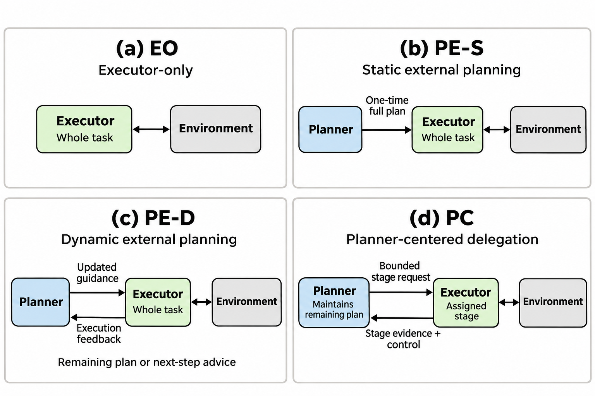
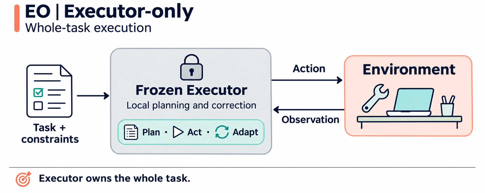
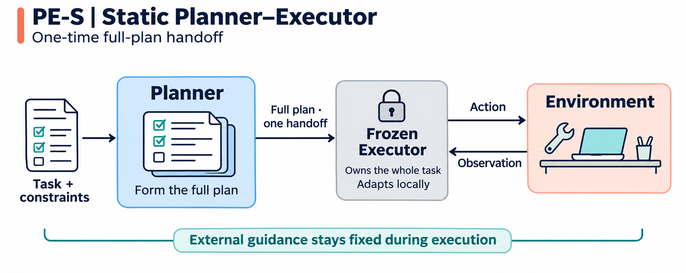
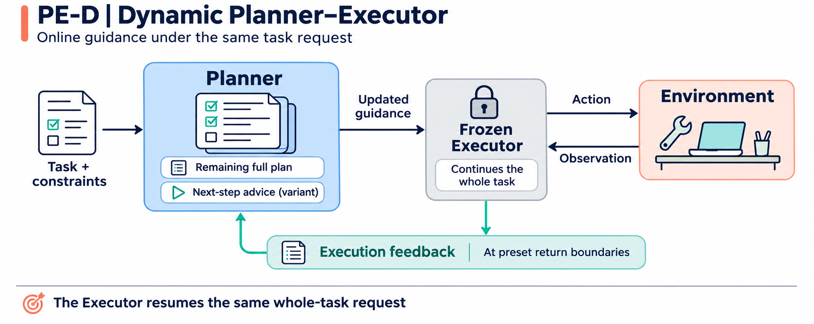
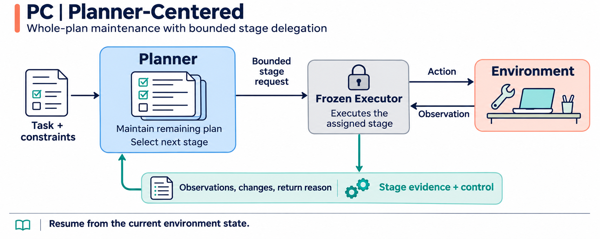

# 高层规划器优化：战略探索与执行证据驱动的学习

> Research Proposal v0.5 · 通过审核\
> 正文修订：2026 年 11 月 18 日\
> [研究者审核记录](RESEARCH.md#decisions)

## 摘要

本研究关注如何在固定 Executor 的条件下，通过战略探索、执行证据支持的低成本评价和策略更新，改善高层 Planner 的任务表现。研究的起点是一个尚待验证的观察：为同一任务采样多份规划，可能只得到同一种解法的表达变体；与此同时，区分规划优劣往往需要昂贵且具有随机性的执行反馈。这两个问题可能相互影响：评价偏向已有经验时，新战略也可能因缺少支持而被低估。

本研究按外部 Planner 的介入时机与委派权限定义 EO、PE-S、PE-D 和 PC 四种基础框架。EO 提供 Executor 自主完成任务的参照。其余框架用不同的规划接口研究战略探索、低成本评价和 Planner 学习。框架选择取决于待研究的决策需要什么证据和控制权。

## 1. 研究问题与动机

高层规划的价值在于影响后续选择：先获取什么信息、先建立哪个前提、如何组织子目标，以及何时改变路线。Executor 可以根据新观察处理局部细节，但如果整条路线选错，局部执行能力未必能补救。因此，我们希望单独训练 Planner，使其在给定执行能力下提出更有用的规划。

已有工作说明，固定执行系统的反馈可以用于优化 Planner。例如，MPO 通过重复执行比较候选 meta plan，并构造偏好数据；EAGLET 使用执行反馈训练 global Planner。[1–2](#references) 它们为本研究提供训练与评价基线，但不能替代对当前困难的诊断。

研究者此前观察到部分候选规划缺少实质不同的战略，目前尚未完成大规模验证。若这一现象成立，增加候选数量可能主要增加同一路线的重复样本。若候选确实不同，但评价噪声或成本使这些差异无法转化为学习信号，问题又会落在评价与更新环节。研究需要区分这些情况，避免为采样、执行或评测造成的问题引入不必要的规划机制。

本研究的核心问题是：

各组保留 Executor 原生的推理、探索、工具使用与纠错。比较时固定 Executor 的模型、基础 prompt、工具权限、采样策略和预算规则。学习实验只更新外部 Planner 参数。实际调用次数与环境交互差异计入端到端成本。

| 框架 | 外部 Planner 何时介入 | 谁负责推进任务 |
| --- | --- | --- |
| EO（Executor-Only） | 无外部 Planner。 | Executor 接收整项任务，自主规划与执行。 |
| PE-S（Static Planner–Executor） | 执行前交付一次整体规划，执行期间保持外部指导不变。 | Executor 持续承担整项任务，可以根据现场观察调整局部策略。 |
| PE-D（Dynamic Planner–Executor） | 在预定返回边界读取反馈，更新指导。主对照维护并修订剩余整体规划。 | Executor 持续承担整项任务，在同一任务请求下吸收更新后的指导。 |
| PC（Planner-Centered） | 在阶段返回后维护剩余整体规划，选择并委派下一个有边界的阶段目标。 | Planner 决定阶段目标与约束，Executor 自主完成被委派的阶段并返回证据。 |

**规划覆盖范围与控制权分别定义。** Full-plan 覆盖整项任务或当前剩余任务。这里的 step-plan 指每轮只生成紧接着要做的高层步骤或阶段建议。PE-D 的主对照采用 **full-plan + dynamic replanning**。若 Planner 只提供下一步建议，Executor 仍持有整项任务，则属于 PE-D 的 step-plan 变体，应与主对照分别记录。若 Planner 下发有界阶段请求并在阶段结束后重新决定下一目标，则采用 PC 的委派协议。PC 可以对 Executor 只下发当前阶段，同时在内部维护剩余整体规划。若保留 PC 的阶段委派协议，但移除显式整体规划状态，可作为检验状态作用的消融。

PE-S 的“一次”指一次交付。首轮基线用一次 Planner 调用，研究规划形成过程时也可在交付前使用多轮推理。若研究只需比较交付前的路线，PE-S 提供直接的实验接口。若需要根据执行中新出现的证据修订全局路线，可使用 PE-D 的 full-plan 版本。若问题只涉及在线给出下一步建议，可用 step-plan 版本。若要研究 Planner 如何选择取证目标、划分阶段、设定约束或决定何时交还控制权，使用 PC 的阶段接口。

**图 1. 四种框架的运行时信息流。** Executor 与环境持续交换行动和观察。PE-D 在预定边界接收反馈，主对照更新剩余整体规划，step-plan 变体只更新下一步建议。PC 在阶段返回边界接收证据并收回控制权。各组共用独立的终局验收规则，验收结果与在线决策隔离。

**图 1(a) 详图. EO 的任务内循环。** 固定 Executor 接收原始任务和约束，自主规划、行动和纠错。

**图 1(b) 详图. PE-S 的一次性交付。** Executor 执行期间可以根据观察调整局部策略，外部指导保持不变。

**图 1(c) 详图. PE-D 的在线指导。** 主对照更新剩余整体规划，step-plan 变体给出下一步建议。两者都在同一个整项任务请求下续接。

**图 1(d) 详图. PC 的阶段委派。** 每次委派包含原始任务、阶段目标与约束。Executor 在同一环境中完成本阶段并返回证据及返回原因，Planner 再决定下一阶段或提出结束建议。

### 2.1 Planner-Centered 的在线闭环

外层由 Planner 和固定运行规则维护任务级状态。内层由 Executor 维持原生的推理、行动与观察循环。一个任务内延续 Executor 会话与环境状态。阶段委派中的真实操作可以同时取证和推进任务，其影响保留到下一阶段。

| 环节 | 首版接口与边界 |
| --- | --- |
| 规划状态 | 维护原始目标、硬约束、已观察事实、证据来源、未验证先验、暂定整体规划和剩余工作。Planner 只使用运行中实际可见的信息。 |
| 高层决策与委派 | Planner 可以维持或修订路线、提出结束建议，或发送包含阶段目标、硬约束、相关证据与软建议的请求。Executor 可以依据现场观察调整局部路线。 |
| 控制权返回 | 固定运行规则在原生返回或满足预算条件且可安全返回时交还控制权。Executor 无需主动调用 Planner。阶段完成与整项任务结束分别记录。 |
| 执行反馈 | 运行层按固定规则收集原始工具事件、Executor 陈述、产物引用、可见变化和返回原因，保留各自来源。离线验收结果与隐藏状态隔离于在线决策。 |

PC 的评价单位是从任务初态出发的高层决策序列及其完整执行轨迹。每个决策都关联当时模型可见的证据，运行器的剩余额度另记于日志，不作为模型输入。首版的运行层只负责请求、续接、预算和证据收集。后端须具备可审查轨迹、可用返回边界和持续会话能力。后续若引入模型摘要、独立审计或其他辅助组件，需单独计入成本并识别其作用。

## 3. 研究思路

### 3.1 战略探索：理解不足是否限制了候选空间？

首先需要观察候选之间究竟改变了什么。措辞、步骤数量或文本距离不足以说明战略不同；更有意义的差异包括信息获取路线、关键前提、子目标依赖和资源使用方式。还需检查这些差异是否影响固定 Executor 的行为。

一种值得研究的解释是：候选共享了同一个未经确认的任务理解，所以采样始终围绕同一路线展开。例如，所有候选都默认某项资源可用，即使增加温度，也可能只生成这一假设下的变体。若候选暴露的矛盾能够促使 Planner 获取相关信息、重新判断依赖关系，就可能打开另一类解法。

多轮形成、经验检索、元规划复用和树搜索都可以服务于这一问题，但尚未选定其中任何一种作为必需组件。比较应从独立采样、长单次推理和简单修订等强基线出发，判断收益来自更多计算、额外信息，还是更有效的信息选择与战略改变。最终保留哪种机制，由观察和学习结果决定。

在一次性交付框架中，比较交付的高层路线及其诱导的执行行为。在 PE-D 与 PC 中，战略差异还包括遇到不同证据时如何改变后续路线。PC 还可以选择先委派哪个取证或执行目标。重点观察新证据是否改变子目标依赖、关键资源选择或恢复路线。

### 3.2 低成本评价：什么证据足以支持规划判断？

完整执行能够提供任务结果，但一次结果只是样本。失败可能来自规划错误、Executor 能力或随机性；重复执行能减少部分随机误差，却会增加成本。我们希望研究是否可以利用已有执行记录、关键条件检查或部分执行，在适当范围内形成有用的规划评价。

评价必须明确自己在判断什么。确认一个前提成立，与预测整份规划会成功，是不同任务；局部执行没有失败，也不意味着终局价值已经确定。如果部分执行改变了环境，需要明确使用独立副本、恢复状态，还是从新状态续跑；后者评价的是包含取证过程的策略，不能直接当作原始状态下候选规划的比较。如果便宜信号只是新的训练目标，应通过最终任务表现证明它有用，不能将其直接当作真实价值。

探索与评价的冲突可能出现在这里。依赖经验的评价器可能低估陌生路线，截短执行可能低估“先获取信息、后取得进展”的策略。保留“目前无法判断”是一个候选处理方式：它可以触发补充证据，或暂不形成强排序，而不自动把未知判成失败。是否采用这种处理及如何用于更新，仍需比较。

成功、成本与轨迹从同一执行记录中提取，取证过程计入总成本。重复执行均值是基线或校准参照，低成本评价需要在判断质量与实际开销之间展示收益。

PC 首版在同一个持续环境中从当前状态续跑。一个阶段可能同时提供证据、消耗资源和改变后续可达状态。若需校准整个策略的价值，可以让不同策略从可复现的同一初态独立运行。若只比较局部决定，需说明各自决策时模型可见的历史与状态，并核对运行器的预算设置。局部证据支持的判断范围与终局表现分别记录。

### 3.3 策略更新：从规划形成到在线高层决策

如果训练只保留最终好计划，模型可以学习交付内容，却未必学会何时检索、如何检查关键假设和何时停止修订。若形成过程本身包含有价值的决定，就需要考虑保留各轮可见信息、选择与反馈，学习整个形成过程。两种学习对象均可保持 Executor 固定，但它们需要不同的数据和比较方式。

在 PC 中，候选学习对象包括规划内容、证据与规划状态的维护，以及高层委派与修订决策。若进入训练，轨迹应保留各轮已知信息、选择、反馈、状态变化与最终结果。在线证据可以直接改变本次任务的后续规划。参数更新则要明确使用什么训练信号，以及它是否改善未见任务表现。终局成败可评价完整策略，局部信用分配需要额外验证。

初期可以使用已有监督微调、偏好学习或强化学习方法建立完整闭环，不提前锁定 GRPO 或奖励公式。由教师、外部搜索和当前 Planner 产生的数据应区分来源，不能将经过编辑的最终规划无条件当作原策略的一次采样。

已有 SFT 数据也可能继续用于示范、经验检索或后续监督。这里值得研究的是它们补充了什么信息，以及何时帮助探索和学习。旧示范不自动代表当前 Executor 下的好策略，只有最终规划的数据也不能凭空提供真实的检索与修订过程。相关方法与适用边界在[文献调研](papers/fullplan-optimization-review.md)中单独讨论。

**图 2. 候选学习流程。** 形成战略候选、获取执行证据、构造学习信号并更新 Planner。具体探索、评价和更新方法尚未选定；独立测试使用冻结后的 Planner，不向训练回传测试结果。

## 4. 如何判断研究是否取得进展？

验证需要连接“候选变了什么”“评价依据是什么”和“最终学到了什么”。只提高文本多样性、代理分数或训练回报，都不足以回答研究问题。

| 要回答的问题 | 主要证据 | 需要排除的替代解释 |
| --- | --- | --- |
| 是否探索到更有价值的战略？ | 任务相关的决策差异、执行行为变化及真实结果。 | 只有措辞变化、无效路线，或仅增加采样／推理投入。 |
| 评价是否更有效率？ | 候选比较的可靠性、未知与错误覆盖、完整执行需求及全部评价成本。 | 漏计检索、模型与校准成本；通过忽略陌生候选获得表面稳定。 |
| 反馈是否改善了 Planner？ | 相同执行协议下，未见任务的成功与成本表现。 | 收益来自更强 Executor、测试时额外搜索、数据泄漏或单次偶然结果。 |

### 4.1 架构比较与机制诊断

共用任务、Executor、环境接口和离线验收规则，按可比端到端预算衡量未经专项训练的系统配置。按待回答的问题选择对照。

| 对照 | 可回答的问题 |
| --- | --- |
| PE-S 与 EO | 在 Executor 保留原生规划能力时，初始外部规划带来多少净收益与成本？ |
| PE-D 与 PE-S | 在 Executor 持续承担整项任务时，允许 Planner 根据反馈更新整体指导的配置增量有多大？差异也包括额外调用与状态维护。 |
| PC 与 PE-D | 在尽量对齐 Planner 模型、初始规划、反馈来源、状态容量、调用边界、会话策略和预算后，将阶段委派交给 Planner 有什么作用？ |
| PC 与 EO 或 PE-S | 完整闭环系统相对自主执行或一次性外部指导的整体效果如何？ |

首轮可用 EO、PE-S、PC 筛查系统差异。若要解释阶段委派的作用，则需要 PE-D。对齐的是反馈获取规则和可见范围，委派产生的实际轨迹差异属于待测效果。若返回或续接协议无法对齐，则按配置差异解释结果。

待检验的假设是，PC 的净收益更可能出现在新证据会改变全局选择、存在跨阶段依赖或需要恢复的任务中。高层路线稳定、Executor 已能局部消化反馈，或外部指导过度细化时，PC 可能增加开销或干扰执行。任务结构应在运行前定义，机制判断需要追踪证据到达、计划变化与后续行为，并通过相应干预测试。

### 4.2 Planner 优化的证据

一次性交付实验可复用实验工具集，PC 原型需核查后端的返回与续接能力。已有采样诊断用于识别战略差异和错误类型，其结果对应一次性交付设置。[实验工具集](src/toolkit/README.md)

方法构建保留完整的“规划—执行—反馈—更新”环节。需要学习闭环才能观察的收益，可以直接在原型中检验，无需先证明每个组件单独有效。优化对照在各自架构内固定运行协议，比较初始或 SFT Planner 与改进方法在未见任务上的成功和成本。探索与评价可分别对照独立候选采样、单次及重复执行。需要定位机制时，针对已观察到的瓶颈改变一个环节，并控制信息量与计算投入。跨架构比较使用相同任务、冻结 Executor 和可比预算，分别报告架构效果与优化增量。

主结果同时报告成功率、所有尝试的执行成本和规划形成成本。成功条件下的长度可以补充，但不能忽略失败消耗与成功任务集合变化。数据划分须覆盖训练、验证、测试，以及检索和评价器的数据来源；报告多 seed 或相应置信区间，并保留失败轨迹。训练资源不预设固定总配额，但方法比较中的重要投入差异必须披露。

跨 Executor 复用保留为后续分析，用于考察所学策略的适用范围。它不要求初始方法引入多执行器训练，也不作为主方法成立的必要条件。

## 5. 推进方式与预期贡献

一次性交付研究可沿用采样诊断，明确规划接口、评价证据与学习对象。在线框架先核对返回协议与日志，再通过未训练对照观察差异。后续根据待验证的决策和轨迹证据选择 PE-S、PE-D 或 PC 作为优化载体。是否继续优化内容、状态维护或控制决策，由证据决定。进入方法实验时保留完整的规划、执行、反馈和更新闭环。训练优先沿用 1.5B–13B 范围，模型、任务集、预算和运行规模在实施设计中确定。

若基线已经覆盖有效战略，应重新检查评价与执行，而不是继续扩大探索机制。若新评价更便宜但误导学习，需要修订其使用范围。若更多轮次的收益完全由额外信息或计算解释，应据此收缩结论。小规模结果只约束覆盖的设置，不能据此否定所有候选，也不能据此声称普遍有效。

预期贡献是识别一个明确的 Planner 学习困难，提出有针对性的机制，并解释它在什么条件下改善真实任务表现。架构解耦、多轮调用、常规 SFT→RL 或重复执行均值本身，都不作为创新主张。研究可以只在其中一个环节形成主要贡献，其余环节使用成熟方法。

## 6. 版本与来源

本稿整合 2026-11-18 的《面向自主执行器的 Planner-Centered 闭环规划优化》v0.1（`Planner_Centered_Research_Proposal.pdf`）。其系统净效应、机制与任务条件问题用于界定 PC 分支的架构证据。研究主问题仍是战略探索、低成本评价和 Planner 更新。四种框架的对照口径沿用 2026-11-18 的 Planner-Centered 测试工作稿（`Planner_Centered_Test_Proposal.pdf`），其中 PE-D 取自 §6.2。架构、训练与泛化收益均待实验检验。

## 参考资料

1. [MPO: Boosting LLM Agents with Meta Plan Optimization，§3](https://arxiv.org/html/2503.02682v2#S3)。执行反馈与偏好学习的直接比较依据。
2. [A Goal Without a Plan Is Just a Wish（EAGLET），§3.2](https://arxiv.org/html/2510.05608v3#S3.SS2)。冻结 Executor 的 global Planner 训练近邻。

详细文献筛选、方法比较与代码证据分别保存在两份调研中：[full-plan 优化](papers/fullplan-optimization-review.md)；[Planner-Centered 架构](papers/planner-centered-review.md)。
