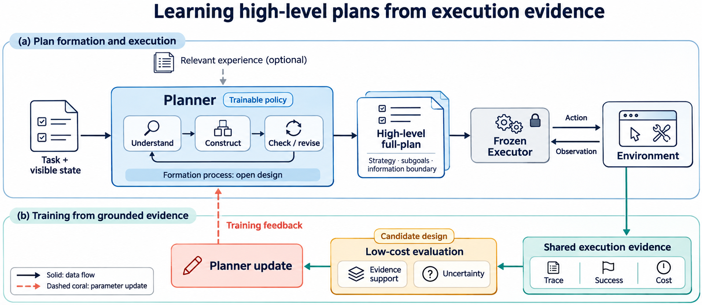
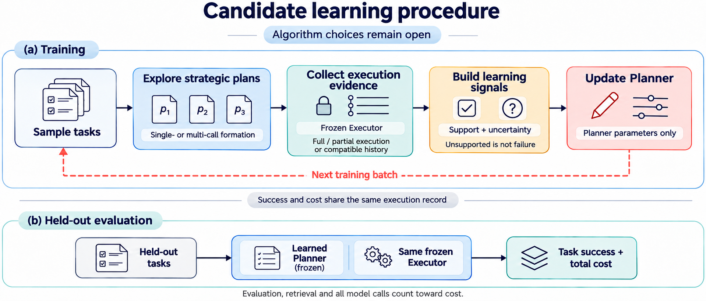

# 高层规划器优化：战略探索与执行证据驱动的学习

> Research Proposal v0.4 · 修订稿  
> 正文修订：2026 年 11 月 11 日  
> [研究者审核记录](RESEARCH.md#decisions)

## 摘要

本研究关注如何在固定 Executor 的条件下，通过战略探索、执行证据支持的低成本评价和策略更新，改善高层 Planner 的任务表现。研究的起点是一个尚待验证的观察：为同一任务采样多份规划，可能只得到同一种解法的表达变体；与此同时，区分规划优劣往往需要昂贵且具有随机性的执行反馈。这两个问题可能相互影响：评价偏向已有经验时，新战略也可能因缺少支持而被低估。

我们保留 Planner 形成高层 full-plan、Executor 负责具体执行的架构，并研究规划形成过程是否能产生更有价值的战略差异。一份规划可以经过任务理解、经验检索、候选比较和修订后再交付，调用次数与规划覆盖范围分别定义。后续将以真实任务执行为依据，比较不同探索与评价方式能否支持有效的 Planner 学习。预期贡献落在可验证的学习机制及其适用条件，不预设多轮生成、架构分离或某一种训练算法本身构成创新。

## 1. 研究问题与动机

高层规划的价值在于影响后续选择：先获取什么信息、先建立哪个前提、如何组织子目标，以及何时改变路线。Executor 可以根据新观察处理局部细节，但如果整条路线选错，局部执行能力未必能补救。因此，我们希望单独训练 Planner，使其在给定执行能力下提出更有用的规划。

已有工作说明，固定执行系统的反馈可以用于优化 Planner。例如，MPO 通过重复执行比较候选 meta plan，并构造偏好数据；EAGLET 使用执行反馈训练 global Planner。[1–2](#references) 它们为本研究提供训练与评价基线，但不能替代对当前困难的诊断。

研究者此前观察到部分候选规划缺少实质不同的战略，目前尚未完成大规模验证。若这一现象成立，增加候选数量可能主要增加同一路线的重复样本。若候选确实不同，但评价噪声或成本使这些差异无法转化为学习信号，问题又会落在评价与更新环节。研究需要区分这些情况，避免为采样、执行或评测造成的问题引入不必要的规划机制。

本研究的核心问题是：

> **如何探索具有任务价值的高层策略，以可承受的执行证据成本评价它们，并将这些反馈转化为 Planner 在未见任务上的改进？**

当前更重视探索多样性。是否需要为评价效率限制探索，要由实际候选和评价机制决定。研究不要求在探索、评价和更新三个环节同时提出新算法。

## 2. 研究设定与主线架构

Planner 与 Executor 使用独立参数。主实验只更新 Planner 策略，固定 Executor 的模型、prompt、工具权限、采样策略和预算规则。不同 Planner 可以产生不同调用次数与执行轨迹，这些差异同时计入效果和成本。

Planner 交付的是面向整项任务的高层规划，而非完整的低层动作清单。它需要表达有作用的策略、子目标关系与当前信息支持的判断，并给 Executor 留出适应新观察的空间。具体表示尚未确定。

**图 1. 研究主线。** Planner 形成规划，固定 Executor 与环境交互，执行证据用于评价和训练反馈。内部形成过程与低成本评价均为待研究机制，图中不包含在线 Planner-Centered 控制。

分离 Planner 是为了明确高层决策的职责和优化接口，不意味着推理与规划是互斥活动。Planner 可以在形成规划时反复推理，Executor 也可以在执行时推理。我们关注的是哪些决定由谁作出、它们依赖什么信息，以及如何评价和学习这些决定。

同样，full-plan 描述规划覆盖范围，单次或多次调用描述形成过程。已有文献不能支持“所有 full-plan 优化都默认单轮 prompt”的概括；本研究也不依赖这一概括成立。与当前设置接近的方法、内部修订先例及其证据强弱，另见[full-plan 文献调研](papers/fullplan-optimization-review.md)。

## 3. 研究思路

### 3.1 战略探索：理解不足是否限制了候选空间？

首先需要观察候选之间究竟改变了什么。措辞、步骤数量或文本距离不足以说明战略不同；更有意义的差异包括信息获取路线、关键前提、子目标依赖和资源使用方式。还需检查这些差异是否影响固定 Executor 的行为。

一种值得研究的解释是：候选共享了同一个未经确认的任务理解，所以采样始终围绕同一路线展开。例如，所有候选都默认某项资源可用，即使增加温度，也可能只生成这一假设下的变体。若候选暴露的矛盾能够促使 Planner 获取相关信息、重新判断依赖关系，就可能打开另一类解法。

多轮形成、经验检索、元规划复用和树搜索都可以服务于这一问题，但尚未选定其中任何一种作为必需组件。比较应从独立采样、长单次推理和简单修订等强基线出发，判断收益来自更多计算、额外信息，还是更有效的信息选择与战略改变。最终保留哪种机制，由观察和学习结果决定。

### 3.2 低成本评价：什么证据足以支持规划判断？

完整执行能够提供任务结果，但一次结果只是样本。失败可能来自规划错误、Executor 能力或随机性；重复执行能减少部分随机误差，却会增加成本。我们希望研究是否可以利用已有执行记录、关键条件检查或部分执行，在适当范围内形成有用的规划评价。

评价必须明确自己在判断什么。确认一个前提成立，与预测整份规划会成功，是不同任务；局部执行没有失败，也不意味着终局价值已经确定。如果部分执行改变了环境，需要明确使用独立副本、恢复状态，还是从新状态续跑；后者评价的是包含取证过程的策略，不能直接当作原始状态下候选规划的比较。如果便宜信号只是新的训练目标，应通过最终任务表现证明它有用，不能将其直接当作真实价值。

探索与评价的冲突可能出现在这里。依赖经验的评价器可能低估陌生路线，截短执行可能低估“先获取信息、后取得进展”的策略。保留“目前无法判断”是一个候选处理方式：它可以触发补充证据，或暂不形成强排序，而不自动把未知判成失败。是否采用这种处理及如何用于更新，仍需比较。

成功、成本与轨迹从同一执行记录中提取，取证过程计入总成本。重复执行均值是基线或校准参照，低成本评价需要在判断质量与实际开销之间展示收益。

### 3.3 策略更新：反馈应改变最终规划，还是规划形成过程？

如果训练只保留最终好计划，模型可以学习交付内容，却未必学会何时检索、如何检查关键假设和何时停止修订。若形成过程本身包含有价值的决定，就需要考虑保留各轮可见信息、选择与反馈，学习整个形成过程。两种学习对象均可保持 Executor 固定，但它们需要不同的数据和比较方式。

初期可以使用已有监督微调、偏好学习或强化学习方法建立完整闭环，不提前锁定 GRPO 或奖励公式。由教师、外部搜索和当前 Planner 产生的数据应区分来源，不能将经过编辑的最终规划无条件当作原策略的一次采样。

已有 SFT 数据也可能继续用于示范、经验检索或后续监督。这里值得研究的是它们补充了什么信息，以及何时帮助探索和学习。旧示范不自动代表当前 Executor 下的好策略，只有最终规划的数据也不能凭空提供真实的检索与修订过程。相关方法与适用边界在[文献调研](papers/fullplan-optimization-review.md)中单独讨论。

**图 2. 候选学习流程。** 形成战略候选、获取执行证据、构造学习信号并更新 Planner。具体探索、评价和更新方法尚未选定；独立测试使用冻结后的 Planner，不向训练回传测试结果。

## 4. 如何判断研究是否取得进展？

验证需要连接“候选变了什么”“评价依据是什么”和“最终学到了什么”。只提高文本多样性、代理分数或训练回报，都不足以回答研究问题。

| 要回答的问题 | 主要证据 | 需要排除的替代解释 |
| --- | --- | --- |
| 是否探索到更有价值的战略？ | 任务相关的决策差异、执行行为变化及真实结果。 | 只有措辞变化、无效路线，或仅增加采样／推理投入。 |
| 评价是否更有效率？ | 候选比较的可靠性、未知与错误覆盖、完整执行需求及全部评价成本。 | 漏计检索、模型与校准成本；通过忽略陌生候选获得表面稳定。 |
| 反馈是否改善了 Planner？ | 相同执行协议下，未见任务的成功与成本表现。 | 收益来自更强 Executor、测试时额外搜索、数据泄漏或单次偶然结果。 |

实验以[实验工具集](src/toolkit/README.md)为现有评估入口，但不受其默认规划模板限制。首先需要在真实任务上观察足够的规划与执行数据，校准战略差异和错误类型；已有小批生成仅作为初步线索，不承担总体结论。

方法构建保留完整的“规划—执行—反馈—更新”环节。需要学习闭环才能观察的收益，可以直接在原型中检验，无需先证明每个组件单独有效。主要对照包括初始或 SFT Planner、独立候选采样、单次及重复执行评价，以及仅改变探索、仅改变评价和完整组合。若采用多轮形成，再匹配信息量与计算投入，区分过程组织的作用。

主结果同时报告成功率、所有尝试的执行成本和规划形成成本。成功条件下的长度可以补充，但不能忽略失败消耗与成功任务集合变化。数据划分须覆盖训练、验证、测试，以及检索和评价器的数据来源；报告多 seed 或相应置信区间，并保留失败轨迹。训练资源不预设固定总配额，但方法比较中的重要投入差异必须披露。

跨 Executor 复用保留为后续分析，用于考察所学策略的适用范围。它不要求初始方法引入多执行器训练，也不作为主方法成立的必要条件。

## 5. 推进方式与预期贡献

审阅后，先明确一轮原型需要的规划接口、可用证据和学习对象，再复用已有方法建立闭环。战略探索不足、评价失真或反馈利用困难，仍是待比较的解释；系统构建与实验可以反过来修正它们。训练优先沿用项目的 1.5B–13B 范围，具体模型与运行规模在实施设计中确定。

若基线已经覆盖有效战略，应重新检查评价与执行，而不是继续扩大探索机制。若新评价更便宜但误导学习，需要修订其使用范围。若更多轮次的收益完全由额外信息或计算解释，应据此收缩结论。小规模结果只约束覆盖的设置，不能据此否定所有候选，也不能据此声称普遍有效。

预期贡献是识别一个明确的 Planner 学习困难，提出有针对性的机制，并解释它在什么条件下改善真实任务表现。架构解耦、多轮调用、常规 SFT→RL 或重复执行均值本身，都不作为创新主张。研究可以只在其中一个环节形成主要贡献，其余环节使用成熟方法。

## 6. 独立设想：Planner-Centered

Planner-Centered 保留为独立研究分支。其设想是由 Planner 持续维护整体或剩余整体规划，委派有界执行／取证请求，再根据真实反馈修订路线。它不替代本文主线，多轮形成 full-plan 也不要求采用该架构。

这个分支中，执行既可能检验假设，也可能推进任务。因此需要重新界定学习对象、返回控制权的条件和状态变化，不能将所有收益都归给最终规划文本。相近架构、证据筛选与候选接口见[Planner-Centered 架构调研](papers/planner-centered-review.md)。是否构建该分支，留待单独讨论。

## 参考资料

1. [MPO: Boosting LLM Agents with Meta Plan Optimization，§3](https://arxiv.org/html/2503.02682v2#S3)。执行反馈与偏好学习的直接比较依据。
2. [A Goal Without a Plan Is Just a Wish（EAGLET），§3.2](https://arxiv.org/html/2510.05608v3#S3.SS2)。冻结 Executor 的 global Planner 训练近邻。

详细文献筛选、方法比较与代码证据分别保存在两份调研中：[full-plan 优化](papers/fullplan-optimization-review.md)；[Planner-Centered 架构](papers/planner-centered-review.md)。
