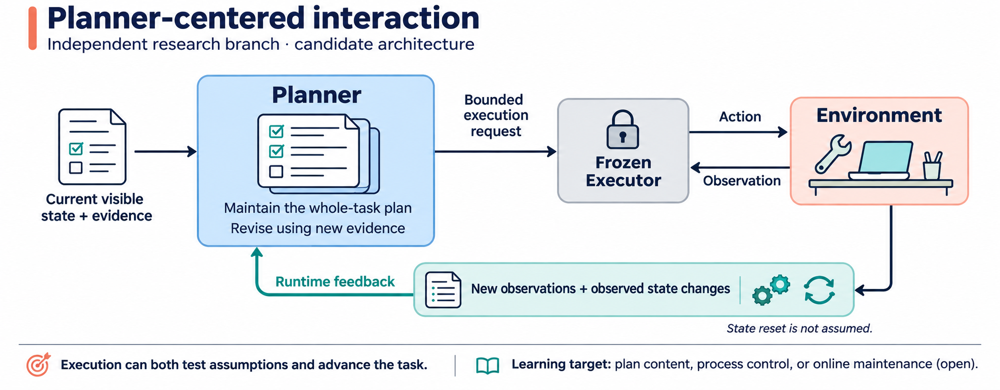

# Planner-Centered：机制近邻与证据边界

核查日期：2026-11-11。本文服务于 [research proposal v0.4](../PROPOSAL.md)，讨论一个尚未采用的独立架构分支。主线仍是独立 Planner 生成高层 full-plan、固定 Executor 执行，再用执行证据支持低成本评价与 Planner 参数更新。本报告没有运行模型、复现实验或产生本项目效果结论。

**“Planner 提出整体规划，Executor 的实际执行提供反馈，Planner 再修订规划”已有明确先例。** AdaPlanner、DEPS 和 Plan-and-Act 是直接机制近邻；ADaPT 提供另一种失败触发的规划组织方式。它们足以否定“这种闭环本身是新的”这一判断，却不足以证明本项目应该改用该架构，或证明它能低成本地产生更多战略并改善学习。

文献的用途需要分开：方法和代码可以证明机制存在；消融与对照用于判断机制为何有效；迁移到本项目的收益还需要核对任务、规划表示、Executor、额外信息和总成本。下面按这些用途评价证据，不把发表场所或论文相关性直接当成可信度。

## 1. 比较的对象

| 对象 | 需要核查的过程 | 与本项目的关系 |
|---|---|---|
| 一次 full-plan 的形成 | 围绕同一规划起点，先提出、检索或检查，再修订并交付完整规划 | 可以保留原主线接口；full-plan 不要求 single-call |
| 在线 remaining-full-plan 的维护 | 执行推进后，维护从当前状态到完成任务的剩余整体规划 | 本报告的主要近邻，属于独立 Planner-Centered 分支 |
| step-plan | 每轮只决定下一子目标、工具或局部指令 | 多轮任务求解不能直接证明一次 full-plan 的生成内部有多轮 |

高层 full-plan 不要求提前填满未知的执行细节；它要表达路线、子目标关系、关键依赖及当前信息的边界。代码式计划是一些近邻采用的表示，本项目并未因此决定使用脚本。模型自评、形式验证、模拟器预测和目标环境中的实际执行也不能合并成同一种“反馈”。

## 2. 四个核心近邻

### AdaPlanner：执行偏差触发整体计划修订

AdaPlanner 生成带子目标注释和断言的代码计划。局部观察可以由 `ask_LLM()` 解释；断言失败后，再结合执行状态修订后续计划并决定续跑位置。其 skill discovery 保存经筛选的成功解与轨迹，供后续提示使用；这是上下文经验复用，没有更新 LLM 参数。[论文 §2–3.3](https://arxiv.org/html/2305.16653)

它最有用的证据是清晰区分了“执行中局部适应”和“改变后续整体计划”。论文在 ALFWorld、MiniWoB 任务上考察纠错轮数、代码表示与 skill discovery，提供了组合机制及若干组件的实验支持。但代码接口本身影响结果，多个组件一起构成方法；这些结果不能直接转译为高层自然语言 Planner 在相同总成本下的收益，也没有验证本项目关心的参数更新或战略多样性。[正式论文 §4、Fig. 4](https://proceedings.neurips.cc/paper_files/paper/2023/file/b5c8c1c117618267944b2617add0a766-Paper-Conference.pdf)

**可借用：** 让规划中的关键预期与实际观察建立对应，局部适应无法解决偏差时才修订整体路线。不能照搬其代码表示、断言可靠性或 skill 库作为本项目的既定设计。

### DEPS：让失败解释和执行能力影响剩余规划

DEPS 先生成子目标序列，由目标条件化控制器执行。执行失败后，当前状态描述和失败解释进入重规划。另有根据离线成功轨迹训练的 horizon-predictive selector，估计完成候选目标所需的步数，帮助选择可执行目标。因此不能把整个方法描述为“完全没有训练”，也不能把 selector 的收益全部归给 LLM 的规划能力。[论文 §3.1–3.3](https://arxiv.org/html/2302.01560v3)

其证据优点是主实验固定低层控制器，71 个 Minecraft 任务各运行 30 次，随机改变位置和生物群系，并提供无 selector 等消融。比较仍有重要限制：§4.1 先概述使用相同 LM，随后却将 GPT/CoT/IM 列为 `text-davinci-03`，PP/CaP/DEPS 列为 `code-davinci-02`。故应优先看同模型比较和内部消融，不能把全部跨方法排名视为纯架构效应。重复试验也不等于已隔离所有反馈、调用量和额外训练的影响。[论文 §4.1–4.3](https://arxiv.org/html/2302.01560v3#S4)

**可借用：** 区分“逻辑上可以完成”与“当前 Executor 能够完成”，把执行能力和已知状态用于修订路线。它没有证明陌生战略的低成本评价已经解决，也不要求本项目新增 selector。

### Plan-and-Act：高层剩余规划的在线维护与训练

Plan-and-Act 的动态版本在每个 Executor action 后，结合当前状态、旧计划与动作历史生成新的剩余高层规划。其 Planner 和 Executor 分别使用合成数据微调，动态重规划也有专门的数据构造与训练；这与只优化 Planner 的项目设置有差异。[论文 §3.1–3.4、§4.2.1、§5.1](https://arxiv.org/html/2503.09572v3)

这种差异并不意味着其所有比较都无效：Table 1 把 Executor 配置放在列中，可在同一列内查看 Planner 变化。它是“固定 Executor 时规划模块仍可影响结果”的直接参考。但动态重规划行同时涉及训练数据与在线调用变化，最后的 CoT 设置还影响 Planner 和 Executor，不能把总增益都归因于某一个 Planner 决策机制。论文也明确指出每动作重规划的效率问题。[论文 Table 1、§5.3、结论](https://arxiv.org/html/2503.09572v3#S5)

**可借用：** 显式保留剩余整体计划、计划历史和当前状态，构造中间状态下的重规划样本，并做固定 Executor 的内部对照。它的任务内多轮重规划，仍不能单独证明“每次生成一份规划的内部过程”采用了多轮反馈。

### ADaPT：先尝试执行，失败后按能力分解

ADaPT 先由 Executor 尝试任务；失败后才调用 Planner 分解为带 AND/OR 关系的子任务，再递归执行。它使用固定提示，没有参数更新；成功判断包含 LLM 产生的 heuristic，最终任务成功与这个内部判断需要区分。它不是预先生成并持续修订一份固定层级的完整路线。[论文 §3、附录 A/B](https://arxiv.org/html/2311.05772v2)

论文在三个环境中比较执行器直接求解、重复执行、静态分解等方法，并考察分解深度和模型能力，适合支持“规划粒度可以根据 Executor 的实际能力调整”这一机制判断。附录 A 明确说明因成本限制，每个 LLM 只报告一次运行；这限制了方差和稳定性结论。其成功前缀恢复还依赖具体环境实现，不能从高层算法图推断可直接迁移到不可逆任务。[论文 §4–6、附录 A](https://arxiv.org/html/2311.05772v2#A1)

**可借用：** 把需要进一步规划的触发条件与 Executor 的实际困难联系起来。不能据此认定所有失败都应继续分解，也不能把递归分解等同于战略路线探索。

## 3. 官方代码揭示的状态语义

下述判断来自固定提交的控制流阅读，没有运行复现。

| 实现 | 核查到的行为 | 对原型设计的意义 |
|---|---|---|
| AdaPlanner，提交 `dba187601500e7d91fee5fd786a455aaa7988677`，[ALFWorld notebook](https://github.com/haotiansun14/AdaPlanner/blob/dba187601500e7d91fee5fd786a455aaa7988677/ALFWorld/alfworld.ipynb) | `start_episode` 开始时 reset；异常捕获保留局部变量；修改后通过 `modify_header`、`start_from` 续跑。外层修订重试中没有再次 reset 环境；后续即使从代码第一步开始，也不等于恢复环境初态 | 重规划面对的是已被行动改变的环境。保留代码前缀与保留实际状态不是同一件事 |
| ADaPT，提交 `ecdc4ab0030b4be9be122622d8ea78f8c59c44c4`，[ALFWorld](https://github.com/archiki/ADaPT/blob/ecdc4ab0030b4be9be122622d8ea78f8c59c44c4/run_alfworld.py#L476)、[WebShop](https://github.com/archiki/ADaPT/blob/ecdc4ab0030b4be9be122622d8ea78f8c59c44c4/run_webshop.py#L881) | `plan_and_run` 先 reset，再重放 `past_action_checkpoint`；成功子任务的动作进入 checkpoint，失败分支可被丢弃后重试 | 这里的“接着做”依赖重置和前缀重放。迁移时需要验证重放能否恢复相关状态，并将其计入成本 |

因此，不能把两者都压缩为无差别的“失败后继续执行”。若一次取证已推进现实任务，后续交付的是新状态下的 remaining-full-plan；若要比较同一初态下各候选的质量，则需另行明确只读、沙箱或状态恢复条件。无法 reset 不表示系统不可实现，而是要求把状态变化纳入求解与评价对象。

AdaPlanner 的包装器还有在动作发出前更新部分自报字段的实现细节。它提示我们应区分包装器记录与环境确认的事实；本轮没有验证该细节是否造成论文中的任何错误。

## 4. 较弱的补充证据：PIVOT

PIVOT 的 Plan–Inspect–Evolve–Verify 将执行轨迹与原计划比较，尝试保留受支持的前缀并修复后缀。它可提供局部修订的机制启发，但本报告不使用它作为该架构有效、稳定或具有新颖性的核心依据。[论文 v1，§3](https://arxiv.org/html/2605.11225v1#S3)

限制来自主张和证据之间的距离：接受规则针对估计损失，不能保证真实任务质量单调提高；语言反馈定位的最早错误也不是已证明的因果归因。本轮未核实其可运行代码及修改环境后的恢复机制。论文提供了组件消融并区分自主反馈与人类反馈，但仍承认动态环境没有系统验证、反馈可用性和迭代成本构成限制。[论文 §4.1–4.3、Limitations](https://arxiv.org/html/2605.11225v1#S4)

这些缺口限制它能支持的结论，并非因其预印本身份而一概否定。若未来需要借用其修复规则，下一项核查应是可执行实现、状态处理及相同反馈/成本条件下的比较，而不是引用其概括性性能结论。

## 5. 独立分支的候选骨架

图示是尚待界定与验证的分支，不是对主线的替换。其最小闭环可以表述为：当前可见信息、已有证据与整体规划进入 Planner；Planner 保留或修订路线，并委派有边界的执行目标；固定 Executor 执行后返回新观察、局部结果与可观察的状态变化。执行可以同时验证假设和推进任务。

要避免只是给任意 agent loop 换名，这个对象至少应满足两点：持续维护的规划能对跨子目标选择施加实际约束；反馈能改变这些约束，而不只是补全下一步文本。规划可以保留未知和局部自由度，不能靠预先写满全部动作来获得“完整性”。

一个可研究的接口需要说清：委派的目标或待证条件是什么，Executor 可以自行决定哪些细节，何种事件返回控制权，以及返回证据支持和不支持哪些判断。这些内容不要求各自成为独立模型，也不要求预先引入库或树。

优化对象仍未选定：

| 候选学习对象 | 学习哪些决定 | 需要控制的主要混淆 |
|---|---|---|
| 规划内容生成 | 在固定形成流程中提出和修订高层规划 | 固定检索或检查带来的额外信息，不能全部归为训练收益 |
| 规划形成过程 | 何时取证、修改何种判断、何时交付 | 需评价整段形成过程，计入其模型调用和执行成本 |
| 在线整体规划维护 | 何时修订剩余路线、委派什么目标、何时再次介入 | 状态分布、控制频率和实际交互量同时变化 |

三者不是已决定同时实施的组件。无论选哪一种，都应明确哪些 Planner 参数更新，并固定 Executor 的模型、prompt、工具权限、采样和预算规则。固定 Executor 不要求各种 Planner 产生相同调用次数；调用差异属于需要报告的效果与成本。

## 6. 尚缺什么证据

目前最值得保留的是一个机制问题：**什么新证据会改变全局路线，而不是仅填补局部细节？** 相应地，以下问题仍需原型和对照回答，不能由近邻论文替本项目作答。

- 实际反馈是否改变子目标关系、关键依赖或路线选择？需要与只增加推理预算、纯自我修订和直接提供同一证据区分。
- 规划是否保留恰当的执行自由度？局部事实变化应允许 Executor 适应；全局依赖被推翻时才有必要检查 Planner 是否介入。
- 反馈是否可靠且足够便宜？一次执行失败可能来自 Executor 随机性；若“验证”已完成大部分任务，它属于求解过程，其成本不能从规划评价中消失。
- 更多循环是否改善决策？需要记录新事实、计划版本和实际结果，而不以反思文本合理或轮数更多作为稳定性的证据。
- 经验支持的评价是否压制陌生路线？历史证据不足与策略不好需要区分；这一冲突目前仍是假设，不能据此预先牺牲探索多样性。

这里不把“战略探索—低成本评价—参数更新”三个环节都设为必须创新，也不把跨 Executor 复用作为分支成立的前提。若收益只由更多交互、额外数据或更强 Executor 解释，应据此修正机制判断。

## 7. 核查范围与剩余边界

本轮先读项目已有记录，再核查上述论文原文的方法、实验设置、消融与相关附录，并阅读 AdaPlanner、ADaPT 的官方代码控制流。核心检索式包括 `LLM high level planner execution feedback full plan refinement`、`DEPS describe explain plan select`、`ADaPT executor planner backtracking`、`Plan-and-Act dynamic replanning`、`AdaPlanner in-plan out-of-plan refinement`。覆盖了在线整体规划维护、失败触发分解，以及相邻的外部验证、执行搜索、反思记忆和程序技能机制；此处保留四个最能支撑架构判断的近邻。

未做系统性穷尽检索，也未独立复现论文结果；不能据此声称覆盖所有 Planner 优化。一次 full-plan 形成内部的多轮调用问题由配套调研处理，不能用本报告中的任务内重规划替代。当前证据已足以说明闭环有先例并提炼可复用接口；剩余的本项目适用性、学习对象与收益，需要在接口确定后由有界构建和评价解决。
